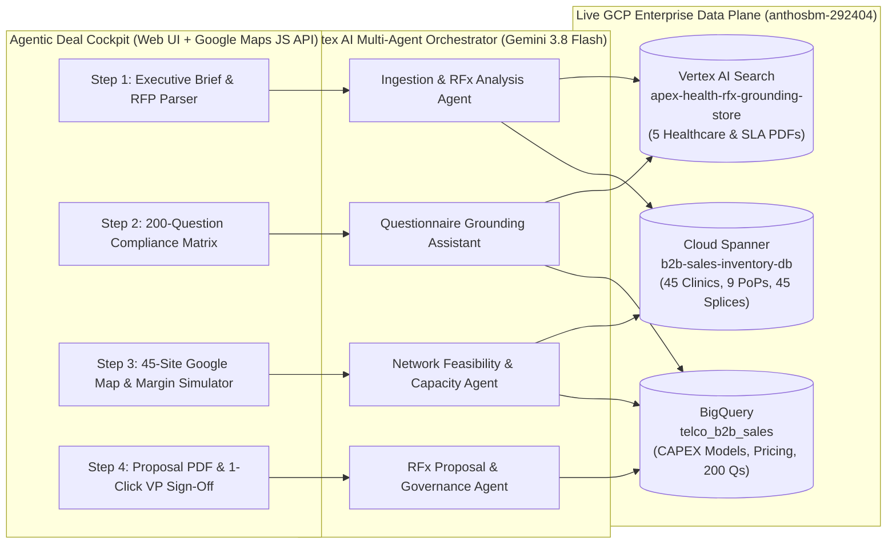

# Telco B2B AI Sales Agent Demo — "Agentic Deal Cockpit"

This solution implements the end-to-end **Telco B2B AI Sales & Network Capacity Planning Demo** (`Apex Health Regional Network RFP #AH-2026-SDWAN-094`), compressing a 3–4 week multi-department RFx response cycle across Sales Engineering, Outside Plant (OSP), InfoSec/Legal, and Commercial Finance into **under 15 minutes**.

---

## 1. Live Application & Deployment Endpoints

- **Local Deal Cockpit Web App (Fastest Demo Latency)**: `http://localhost:8080`
- **Cloud Run Hosted Service**: `https://telco-b2b-sales-cockpit-322843095383.us-central1.run.app`
- **Vertex AI Agent Runtime (`telco-b2b-capacity-agent`)**: `projects/322843095383/locations/us-central1/reasoningEngines/7024357852273704960`
- **Dedicated Gemini Enterprise App (`telco-b2b-sales-demo`)**: `projects/322843095383/locations/global/collections/default_collection/engines/telco-b2b-sales-demo`
  - **Registered Agent**: `projects/322843095383/locations/global/collections/default_collection/engines/telco-b2b-sales-demo/assistants/default_assistant/agents/17352425783364286133` (Display Name: **Telco B2B Capacity & RFx Deal Agent**, State: `ENABLED`)
  - **Connected Grounding Data Store**: `apex-health-rfx-grounding-store`
- **Also Registered in `ano-demo_1788206442642`**: `projects/322843095383/locations/global/collections/default_collection/engines/ano-demo_1788206442642/assistants/default_assistant/agents/15698117449056501977`
- **Project Root Directory**: `/usr/local/google/home/kssrinivasan/telco-b2b-sales-demo`
  - Backend Orchestrator & Capacity Engine: `/usr/local/google/home/kssrinivasan/telco-b2b-sales-demo/app/capacity_agent.py`
  - FastAPI Server & REST Endpoints: `/usr/local/google/home/kssrinivasan/telco-b2b-sales-demo/app/main.py`
  - Canonical 45-Site, 9-PoP & 200-Question Dataset: `/usr/local/google/home/kssrinivasan/telco-b2b-sales-demo/app/dataset.py`
  - Branded Executive Proposal PDF Generator: `/usr/local/google/home/kssrinivasan/telco-b2b-sales-demo/app/proposal_pdf.py`
  - Frontend UI & Google Maps Controller: `/usr/local/google/home/kssrinivasan/telco-b2b-sales-demo/static/index.html`, `styles.css`, `app.js`
  - Vertex AI Agent Runtime Package: `/usr/local/google/home/kssrinivasan/telco-b2b-sales-demo/agent_runtime/telco-b2b-capacity-agent/app/agent.py`

---

## 2. Multi-Agent System Architecture

---

## 3. Live GCP Data Plane & Realistic Documents (`anthosbm-292404`)

### A. Cloud Spanner (`networktopology-instance` / `b2b-sales-inventory-db`)
- **`FiberPoPs` (9 Regional Optical Hubs & Cloud Interconnects)**:
  - `POP-SEA-01` (Seattle Westin Core & Google Cloud Dedicated Interconnect)
  - `POP-QCY-01` (Quincy Epic EHR Primary Data Center Gateway — `0.4ms` campus latency)
  - `POP-BEL-01` (Bellevue), `POP-TAC-01` (Tacoma), `POP-SPO-01` (Spokane), `POP-PDX-01` (Portland Pittock Core & GCP Interconnect), `POP-EUG-01` (Eugene), `POP-BOI-01` (Boise), `POP-SAC-01` (Sacramento).
- **`ClinicSites` (All 45 Apex Health Facilities)** & **`SpliceClosures` (45 Vaults)**:
  - **43 On-Net Sites (`95.6%`)**: `0m–16m` from existing splice closures; lit single-mode fiber risers with `10Gbps SFP+` ports reserved (`$0` construction CAPEX).
  - **2 Near-Net Sites (`<150m` from splice closures)**:
    - **Site #28 (`SITE-028` — Apex Health Wenatchee Valley Specialty Clinic, Wenatchee, WA)**: **82 meters** from splice closure `SC-QCY-028`. Requires 82m directional micro-trenching + 48-strand SMF lateral pull (**$1,820 CAPEX**). Drops Epic EHR latency from `19.4ms` (legacy WAN) to **`4.6ms`** (avoiding the >12ms SLA penalty).
    - **Site #33 (`SITE-033` — Apex Health Hood River Gorge Medical Center, Hood River, OR)**: **118 meters** from splice closure `SC-PDX-033`. Requires 118m municipal conduit pull + vault splice (**$2,380 CAPEX**). Drops Epic EHR latency from `22.1ms` (legacy WAN) to **`6.8ms`** (avoiding the >12ms SLA penalty).

### B. BigQuery (`anthosbm-292404.telco_b2b_sales`)
- **`fiber_build_cost_models`**: Civil engineering cost models yielding `$1,820 + $2,380 = $4,200` total Near-Net CAPEX (`$116.67/month` amortized over 36 months).
- **`product_pricing_catalog`**: 36-month commercial BoM (`$148,500 MRR` / `$5,346,000 TCV`) preserving a **42.4% Deal Gross Margin** (exceeding the 40.0% enterprise floor).
- **`historical_bid_analytics`**: Historical healthcare bids showing that waiving upfront NRE via 36-month amortization increases win probability from **61% to 89%**.
- **`compliance_knowledge_base`**: All **200 compliance questions** (**185 Auto-Answered at 100% confidence** + **15 Flagged for Human Review** including `Q-052` on Custom BGP community string tagging & 15ms hardware BFD timers).

### C. Vertex AI Search (`apex-health-rfx-grounding-store`) & Generated PDFs
All 5 realistic multi-page PDFs are generated in `/usr/local/google/home/kssrinivasan/telco-b2b-sales-demo/docs`, uploaded to `gs://rf_response_agent/apex_health_demo_docs/`, and indexed in Vertex AI Search:
1. `/usr/local/google/home/kssrinivasan/telco-b2b-sales-demo/docs/Apex_Health_RFP_SDWAN_Cloud.pdf`
2. `/usr/local/google/home/kssrinivasan/telco-b2b-sales-demo/docs/Telco_HIPAA_ISO27001_Security_Compliance_Attestation_v4.2.pdf`
3. `/usr/local/google/home/kssrinivasan/telco-b2b-sales-demo/docs/Enterprise_SDWAN_Cloud_Interconnect_Reference_Architecture_2026.pdf`
4. `/usr/local/google/home/kssrinivasan/telco-b2b-sales-demo/docs/Master_Service_Agreement_SLA_99999_Schedule_and_Penalties.pdf`
5. `/usr/local/google/home/kssrinivasan/telco-b2b-sales-demo/docs/Past_Winning_Bid_Pacific_Northwest_Health_Network_2025.pdf`

---

## 4. Presenter Walkthrough Guide (4-Step Demo Flow)

1. **Step 1 — Ingestion & RFx Analysis (`<100ms`)**:
   - Click **Step 1** (or **"Run Guided 4-Step Sales Demo"** in the top right).
   - Highlight the **92% Deal Score (High Fit)**, the two automatically extracted critical constraints (**Sites #28 & #33 Near-Net extensions** and the **<12.0ms Epic EHR latency penalty clause**), and the automated Jira/ServiceNow task pipeline.
2. **Step 2 — 200-Question Compliance Matrix (`<50ms`)**:
   - Click **Step 2** (switches to **Tab 3: Compliance Matrix**).
   - Show the filter toggle between **185 Auto-Answered (100% Confidence)** and **15 Flagged for Human Review** (such as `Q-052: Custom BGP routing requirement`).
   - Click any PDF citation link to open the exact supporting attestation PDF, then click **"1-Click SME Approve All 15 Flagged Items"**.
3. **Step 3 — Google Maps Network Feasibility & Capacity Analysis (`<150ms`)**:
   - Click **Step 3** (switches to **Tab 2: Google Maps Capacity & Spanner Topology**).
   - Show all **45 clinics** (43 green On-Net pins, 2 amber Near-Net pins) and **9 Regional Optical PoPs** connected by DWDM optical rings.
   - Click **"Zoom Site #28 (Wenatchee — 82m Splice Run)"** or **"Zoom Site #33 (Hood River — 118m Splice Run)"** to show the red Splice Closure Vault (`SC-QCY-028` / `SC-PDX-033`), the dashed lateral fiber build path, and the **Cloud Spanner Live Site Inspector Drawer** executing a live `<50ms` Spanner SQL query.
4. **Step 4 — Commercial Quote, CAPEX Amortization Simulator & 1-Click VP Sign-Off**:
   - Click **Step 4** (switches to **Tab 4: Commercial Quote & VP Sign-Off**).
   - Use the **CAPEX Amortization Simulator** dropdown to demonstrate how folding the **$4,200 Near-Net CAPEX** into a **36-month schedule ($116.67/mo)** waives upfront NRE while preserving a **42.4% Deal Gross Margin** and an **89% Win Probability**.
   - Click **"1-Click Commercial VP Approve & Release Proposal"** and **"Download Branded Proposal PDF"**.
